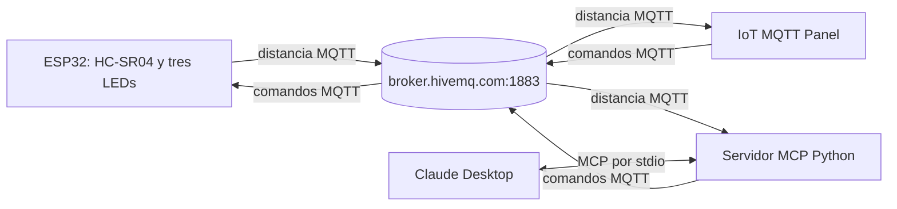

# Plan general — Integración MQTT y MCP

Fecha: 27 de octubre de 2026. Estado: propuesta para aprobación; únicamente se ha preparado la estructura del repositorio. Este documento se archiva sin modificaciones una vez ejecutado.

## 1. Alcance y decisiones

Construir el sistema de la [especificación](../../Práctica_MQTT.md) para el grupo 2: ESP32 DOIT DevKit V1, HC-SR04 alimentado a 5 V, tres LEDs (rojo, amarillo y verde), HiveMQ público, IoT MQTT Panel y Claude Desktop con servidor MCP Python. No hay servomotor ni desarrollo de una app móvil propia.

Se conserva la decisión explícita de publicación cada 1000 ms de AGENTS.md §3.2. Los 200 ms de §6.3 son contradictorios; la especificación permite declarar una frecuencia y presenta ≥2 lecturas/s como referencia. No se modifica la fuente de instrucciones.

Este plan fija arquitectura, contrato y responsabilidades. Pines, métodos, librerías del firmware y mecanismos de temporización se resolverán en el plan detallado del objeto antes de escribir código funcional.

## 2. Arquitectura



ESP32, app y servidor MCP son clientes independientes del broker, sin TLS ni autenticación. Ninguno accede directamente al ESP32. Serial se usa solo para diagnóstico y pruebas locales del hardware. Claude Desktop utiliza exclusivamente las herramientas MCP para consultar datos o ordenar acciones.

Los identificadores tendrán el formato `sis234/grupo2/<role>/<unique-id>`: rol `esp32` con identificador de chip, `mcp` con UUID por proceso, y `panel` con UUID propio de cada instalación. No compartir identificadores entre instancias. Conexiones con sesión limpia y renovación de suscripciones al reconectar, para no ejecutar comandos acumulados durante una desconexión.

## 3. Contrato MQTT propuesto

| Tópico | Publica | Suscribe | QoS publicación/suscripción | Retain |
|---|---|---|---|---|
| `sis234/grupo2/distance` | ESP32 | App y MCP | 0 / 0 | false |
| `sis234/grupo2/leds/cmd` | App y MCP | ESP32 | 1 / 1 | false |

Distancia: `{"cm":42.7}`. `cm` es un número finito entre 5 y 200, en centímetros. Publicar una lectura válida por segundo; ante timeout o medición fuera del rango, omitir esa publicación y no reutilizar una medición antigua como nueva. Las pruebas de frecuencia se realizan con un objeto válido dentro del rango.

Comando: `{"led":"red","state":"on"}`. Las únicas claves son `led` y `state`, obligatorias y de tipo texto. Colores permitidos: `red`, `yellow`, `green`; estados: `on`, `off`. El comando cambia solo el LED indicado y mantiene los demás. Rechazar mensajes malformados, campos adicionales o valores desconocidos sin modificar salidas. Los LEDs arrancan apagados y conservan su estado durante una desconexión sin reinicio.

QoS 0 prioriza la siguiente muestra frente a retransmitir datos que envejecen. QoS 1 para comandos permite duplicados: establecer un estado explícito es idempotente. Sin retención se evita presentar una lectura retenida como reciente o repetir una orden al reconectar. La confirmación del broker no demuestra la ejecución física; no se incorpora un tópico adicional de estado en este alcance.

IoT MQTT Panel: gauge de 5–200 cm, tópico de distancia y JSONPath `$.cm`; seis botones con payload literal para encendido/apagado de cada color. Así cada acción publica un JSON plano sin depender de un estado visual sincronizado. La compatibilidad de JSON, botones y exportación está documentada por el [desarrollador en Google Play](https://play.google.com/store/apps/details?id=snr.lab.iotmqttpanel.prod); [SNR Lab](https://snrlab.in/iot/) confirma JSONPath. Falta comprobar la configuración real en el teléfono. Solo se guardará la exportación producida por la app, nunca un archivo que simule su formato.

## 4. Contrato MCP propuesto

| Herramienta | Parámetros | Propósito |
|---|---|---|
| `get_distance` | Ninguno | Devolver última distancia, antigüedad en segundos y condición de dato reciente, antiguo o ausente |
| `set_led` | `led`: `red`, `yellow`, `green`; `state`: `on`, `off` | Validar y publicar el comando con QoS 1; informar publicación o error, sin afirmar confirmación física |

El servidor guarda únicamente la última lectura válida y su instante de recepción. Se propone considerarla antigua después de 3 s; no esperar una lectura nueva de manera indefinida. Invalidar la caché al perder conexión y no aceptar mensajes retenidos como muestras nuevas. La antigüedad mide tiempo desde recepción, no una marca de tiempo generada por el sensor.

La consulta «¿A qué distancia está el objeto ahora?» usa `get_distance`. «Enciende el LED rojo y apaga los demás» se resuelve con tres llamadas a `set_led`; son acciones independientes, no una transacción atómica. Si falla alguna, la IA debe informar la ejecución parcial.

El plan del servidor fijará respuestas y timeouts concretos, ciclo de vida y concurrencia. Se prevé SDK oficial `mcp` con `FastMCP` y `paho-mqtt`, sin `.env`: broker y tópicos son constantes. Stdio reserva stdout para protocolo y stderr para logs, según la [documentación oficial](https://py.sdk.modelcontextprotocol.io/handlers/logging/). `get_status` pertenece a la base actual; el plan detallado definirá su sustitución por las dos herramientas funcionales.

## 5. Estructura objetivo y responsabilidades

```text
.
├── AGENTS.md
├── Práctica_MQTT.md
├── README.md
├── .gitignore
├── docs/
│   ├── firmware.md
│   ├── mcp-server.md
│   └── plans/
│       ├── 01-general-plan.md
│       ├── 02-firmware-plan.md
│       └── 03-mcp-server-plan.md
├── config/
│   ├── claude_desktop_config.example.json
│   └── iot-mqtt-panel.json
├── firmware/
│   ├── platformio.ini
│   ├── include/
│   │   ├── secrets.example.h
│   │   ├── DistanceSensor.h
│   │   ├── LedController.h
│   │   └── MqttClient.h
│   └── src/
│       ├── main.cpp
│       ├── DistanceSensor.cpp
│       ├── LedController.cpp
│       └── MqttClient.cpp
└── mcp-server/
    ├── server.py
    ├── mqtt_client.py
    ├── requirements.txt
    └── tests/
        └── smoke_test.py
```

El árbol incluye archivos futuros: no crear clases vacías ni planes ficticios. La exportación del panel depende de la versión instalada. Se conservan la especificación y AGENTS.md como fuentes de trabajo, y la prueba MCP existente como verificación de la reorganización.

| Responsable lógico | Archivos y trabajo |
|---|---|
| Integrante 1 — hardware | `DistanceSensor.h/.cpp`, `LedController.h/.cpp`, montaje y validación física; sin WiFi/MQTT |
| Integrante 2 — conectividad | `MqttClient.h/.cpp`, `platformio.ini`, plantilla de secretos y ensamblaje de `main.cpp`; sin acceso directo a pines |
| Integrante 3 — MCP | `server.py`, `mqtt_client.py`, dependencias, prueba MCP y configuración de Claude Desktop; configuración/exportación del panel |
| Los tres | Integración, README, documentos de sus componentes y preparación de demo/defensa |

Asignar los nombres reales a estos roles antes de repartir la implementación. Cada integrante hace sus propios commits; no cambiar autorías. El plan detallado del firmware debe acordar interfaces mínimas de lectura de distancia y control por color, y permitir pruebas separadas (serial para hardware, datos de prueba para conectividad). `main.cpp` solo ensambla objetos y llama a su ciclo de vida.

## 6. Orden de ejecución

1. Preparar la estructura solicitada: renombrar `smart-object/` a `firmware/`, aplanar MCP conservando `get_status`, centralizar documentación y configuraciones, corregir board y exclusiones de Git. No implementar RF1–RF6 en esta etapa.
2. Confirmar el contrato de comandos y aprobar este plan general.
3. Elaborar `02-firmware-plan.md`, con dos partes independientes, pines propuestos, interfaz acordada, librerías, timeouts y pruebas. Confirmar los pines y aprobarlo antes de implementar.
4. Elaborar y aprobar `03-mcp-server-plan.md` usando el mismo contrato MQTT.
5. Implementar las dos partes del firmware y MCP según sus planes aprobados; integrar y actualizar la documentación viva después de cada cambio.
6. Configurar el panel y Claude Desktop; exportar configuración real, ejecutar demo completa y completar nombres/instrucciones del README.

## 7. Verificación de aceptación

| Requisito | Evidencia prevista |
|---|---|
| RF1 y exactitud | Objeto plano perpendicular a 5, 20, 50, 100 y 200 cm; comparar con cinta métrica, error máximo ±3 cm |
| RF2 y frecuencia | Observar publicaciones de lecturas válidas cada 1000 ms con el sistema conectado |
| RF3 y RF5 | Encender/apagar cada LED desde la app y comprobar mensajes inválidos sin cambios físicos |
| RF4 | Gauge o gráfico actualizándose con la distancia real |
| RF6 | Ejecutar ambas frases de ejemplo desde Claude Desktop mediante herramientas MCP |
| Latencia | Medir app → broker → LED con vídeo o cronometraje, máximo 1 s |
| Estabilidad | Operar ≥10 min sin reinicios ni bloqueos, manteniendo medición y control |
| Reconexión | Interrumpir WiFi y MQTT por separado; verificar restablecimiento automático ≤30 s tras volver el servicio, con reintentos cada 5 s |
| Casos de error | Sensor sin eco, mensajes inválidos, ausencia de muestras, datos antiguos y broker no disponible; ninguna espera indefinida |

El firmware deberá mantener `loop()` disponible, temporización con `millis()` y lectura con timeout. El plan detallado debe verificar también los tiempos de conexión de la librería elegida; espaciar reintentos no basta si cada intento bloquea. Las métricas son objetivos declarados, aún no resultados medidos.

## 8. Confirmaciones necesarias

Para cerrar este plan general: confirmar el comando por color `{"led":"red","state":"on"}` (análogos para los otros colores y apagado). La propuesta permite seis botones simples y una única herramienta parametrizada.

La confirmación de pines corresponde al siguiente plan de hardware; no se adopta una asignación implícita en este documento. Una vez ejecutado este plan, cualquier cambio de contrato debe acordarse y reflejarse en firmware, MCP, panel y documentación viva, sin reescribir el plan archivado.
